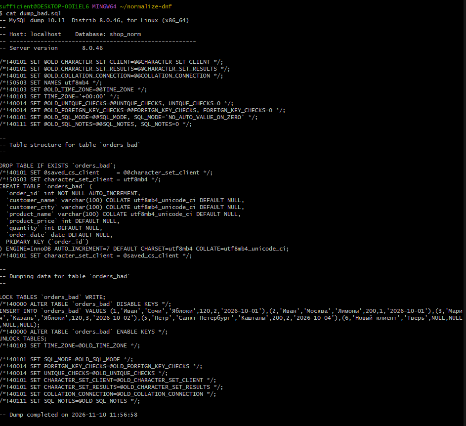
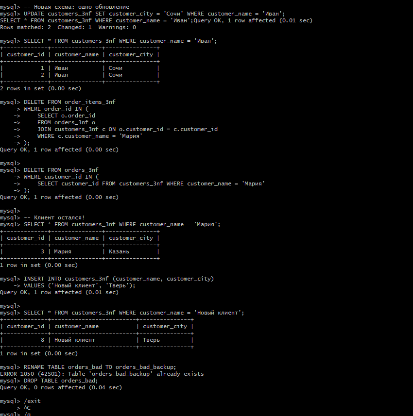

# 📊 Нормализация данных в MySQL (Практическое руководство)

**Окружение:** Windows 10/11, Docker Desktop, Visual Studio Code, Git Bash.

> **Нормализация** — это процесс организации данных в базе, при котором устраняются избыточность и аномалии обновления, вставки и удаления. В этом руководстве мы пройдем путь от «плоской» таблицы до **третьей нормальной формы (3NF)** и научимся логировать все действия пользователя.

---

## 📋 Содержание
1. [Подготовка `my.cnf`](#1-подготовка-mycnf)
2. [Запуск контейнера](#2-запуск-контейнера)
3. [Создание БД и «плохой» таблицы](#3-создание-бд-и-плохой-таблицы)
4. [Демонстрация аномалий](#4-демонстрация-аномалий)
5. [Дамп «плохой» базы](#5-дамп-плохой-базы)
6. [Создание схемы 3NF](#6-создание-схемы-3nf)
7. [Перенос данных](#7-перенос-данных)
8. [Проверка корректности](#8-проверка-корректности)
9. [Повторение операций](#9-повторение-операций)
10. [Дамп нормализованной базы](#10-дамп-нормализованной-базы)
11. [Ведение и экспорт лога](#11-ведение-и-экспорт-лога)

---

## 1. Подготовка `my.cnf`

В папке вашего проекта создайте файл **`my.cnf`** (без расширения `.txt`).

```ini
[mysqld]
character-set-server = utf8mb4
collation-server = utf8mb4_unicode_ci
general_log = 1
general_log_file = /var/lib/mysql/general.log
log_output = FILE

[client]
default-character-set = utf8mb4

[mysql]
default-character-set = utf8mb4


> ⚠️ **Важно для Windows:** 
> 1. Убедитесь, что VS Code не добавил расширение `.txt` к имени файла.
> 2. В правом нижнем углу VS Code кликните на `CRLF` и выберите **`LF`**. Если оставить `CRLF`, MySQL не прочитает конфиг.

---

## 2. Запуск контейнера

Откройте **Git Bash**, перейдите в папку с проектом и выполните:

```bash
docker run --name shop_norm \
  -e MYSQL_ROOT_PASSWORD=123 \
  -e LANG=C.UTF-8 \
  -e MYSQL_INITDB_SKIP_TZINFO=1 \
  -v mysql_data:/var/lib/mysql \
  -v "$(pwd)/my.cnf:/etc/mysql/conf.d/my.cnf" \
  -d mysql:8.0
```

Убедитесь, что контейнер запущен:
```bash
docker ps
```

### 🧹 Очистите лог перед началом работы
При первом запуске MySQL может загружать системные данные. Очистим лог, чтобы в нем остались только ваши действия:

```bash
docker exec shop_norm sh -c ': > /var/lib/mysql/general.log'
```

### 🔌 Подключение к MySQL
```bash
docker exec -it shop_norm mysql --default-character-set=utf8mb4 -uroot -p
```
*(Пароль: `123`)*

---

## 3. Создание БД и «плохой» таблицы

*Все SQL-команды выполняются в клиенте MySQL (приглашение `mysql>`).*

```sql
CREATE DATABASE shop_norm
  CHARACTER SET utf8mb4
  COLLATE utf8mb4_unicode_ci;
USE shop_norm;

CREATE TABLE orders_bad (
    order_id      INT AUTO_INCREMENT PRIMARY KEY,
    customer_name VARCHAR(100),
    customer_city VARCHAR(100),
    product_name  VARCHAR(100),
    product_price INT,
    quantity      INT,
    order_date    DATE
);

INSERT INTO orders_bad (customer_name, customer_city, product_name, product_price, quantity, order_date) VALUES
  ('Иван',  'Москва',          'Яблоки',   120, 2, '2026-10-01'),
  ('Иван',  'Москва',          'Лимоны',   200, 1, '2026-10-01'),
  ('Мария', 'Казань',          'Яблоки',   120, 3, '2026-10-02'),
  ('Мария', 'Казань',          'Хурма',    350, 1, '2026-10-03'),
  ('Пётр',  'Санкт-Петербург', 'Каштаны',  200, 2, '2026-10-04');
```

Проверьте:
```sql
SELECT * FROM orders_bad;
```

---

## 4. Демонстрация аномалий

### 4.1. Аномалия обновления
Обновим город Ивана только в одной строке:
```sql
UPDATE orders_bad SET customer_city = 'Сочи' WHERE order_id = 1;
SELECT * FROM orders_bad WHERE customer_name = 'Иван';
```
**Результат:** У Ивана теперь два разных города («Сочи» и «Москва»). Данные рассогласованы.

### 4.2. Аномалия удаления
Удалим один заказ Марии:
```sql
DELETE FROM orders_bad WHERE order_id = 4;
SELECT * FROM orders_bad WHERE customer_name = 'Мария';
```
**Результат:** Информация о Марии сохранилась только потому, что у нее есть второй заказ. Если удалить все ее заказы, она исчезнет из базы.

### 4.3. Аномалия вставки
Попробуем добавить клиента без заказа:
```sql
INSERT INTO orders_bad (customer_name, customer_city) VALUES ('Новый клиент', 'Тверь');
SELECT * FROM orders_bad WHERE customer_name = 'Новый клиент';
```
**Результат:** Появляется строка с `NULL` в полях заказа. Мы не можем хранить клиента отдельно от заказа.

> ⚠️ **Обязательно удалите эту тестовую строку перед нормализацией!** Иначе она вызовет ошибку `Column 'product_name' cannot be null` при переносе данных.
> ```sql
> DELETE FROM orders_bad WHERE customer_name = 'Новый клиент';
> ```

---

## 5. Дамп «плохой» базы

Выйдите из MySQL (`\q`) и выполните в Git Bash:
```bash
docker exec -e MYSQL_PWD=123 shop_norm mysqldump -uroot shop_norm > dump_bad.sql
```

---

## 6. Создание схемы 3NF

Вернитесь в MySQL:
```bash
docker exec -it shop_norm mysql --default-character-set=utf8mb4 -uroot -p
```
```sql
USE shop_norm;
```

Создайте 4 таблицы:
```sql
-- Клиенты
CREATE TABLE customers_3nf (
    customer_id   INT AUTO_INCREMENT PRIMARY KEY,
    customer_name VARCHAR(100) NOT NULL,
    customer_city VARCHAR(100) NOT NULL
) CHARACTER SET utf8mb4 COLLATE utf8mb4_unicode_ci;

-- Товары
CREATE TABLE products_3nf (
    product_id    INT AUTO_INCREMENT PRIMARY KEY,
    product_name  VARCHAR(100) NOT NULL,
    product_price INT NOT NULL
) CHARACTER SET utf8mb4 COLLATE utf8mb4_unicode_ci;

-- Заказы (шапка)
CREATE TABLE orders_3nf (
    order_id    INT AUTO_INCREMENT PRIMARY KEY,
    customer_id INT NOT NULL,
    order_date  DATE NOT NULL,
    FOREIGN KEY (customer_id) REFERENCES customers_3nf(customer_id)
) CHARACTER SET utf8mb4 COLLATE utf8mb4_unicode_ci;

-- Позиции заказа (строки)
CREATE TABLE order_items_3nf (
    order_id   INT NOT NULL,
    product_id INT NOT NULL,
    quantity   INT NOT NULL,
    PRIMARY KEY (order_id, product_id),
    FOREIGN KEY (order_id)   REFERENCES orders_3nf(order_id),
    FOREIGN KEY (product_id) REFERENCES products_3nf(product_id)
) CHARACTER SET utf8mb4 COLLATE utf8mb4_unicode_ci;
```

---

## 7. Перенос данных

> ⚠️ **Важно:** Из-за внешних ключей очищать таблицы нужно в строгом порядке. Если вам нужно очистить их перед переносом, используйте:
> ```sql
> SET FOREIGN_KEY_CHECKS = 0;
> TRUNCATE TABLE order_items_3nf;
> TRUNCATE TABLE orders_3nf;
> TRUNCATE TABLE customers_3nf;
> TRUNCATE TABLE products_3nf;
> SET FOREIGN_KEY_CHECKS = 1;
> ```

**Выполните перенос по шагам:**

```sql
-- 1. Клиенты
INSERT INTO customers_3nf (customer_name, customer_city)
SELECT DISTINCT customer_name, customer_city FROM orders_bad;

-- 2. Товары
INSERT INTO products_3nf (product_name, product_price)
SELECT DISTINCT product_name, product_price FROM orders_bad;

-- 3. Заказы
INSERT INTO orders_3nf (order_id, customer_id, order_date)
SELECT o.order_id, c.customer_id, o.order_date
FROM orders_bad o
JOIN customers_3nf c
  ON c.customer_name = o.customer_name
 AND c.customer_city = o.customer_city;

-- 4. Позиции
INSERT INTO order_items_3nf (order_id, product_id, quantity)
SELECT o.order_id, p.product_id, o.quantity
FROM orders_bad o
JOIN products_3nf p
  ON p.product_name = o.product_name
 AND p.product_price = o.product_price;
```

---

## 8. Проверка корректности

Сумма всех заказов в старой и новой таблице должна совпасть:
```sql
-- Старая
SELECT SUM(product_price * quantity) AS total_old FROM orders_bad;

-- Новая
SELECT SUM(p.product_price * oi.quantity) AS total_new
FROM order_items_3nf oi
JOIN products_3nf p ON oi.product_id = p.product_id;
```

---

## 9. Повторение операций

Теперь аномалии не страшны:
```sql
-- Обновление города (одно место)
UPDATE customers_3nf SET customer_city = 'Сочи' WHERE customer_name = 'Иван';

-- Удаление заказов Марии (клиент останется в базе)
DELETE FROM order_items_3nf WHERE order_id IN (SELECT order_id FROM orders_3nf o JOIN customers_3nf c ON o.customer_id = c.customer_id WHERE c.customer_name = 'Мария');
DELETE FROM orders_3nf WHERE customer_id IN (SELECT customer_id FROM customers_3nf WHERE customer_name = 'Мария');

-- Добавление клиента без заказа
INSERT INTO customers_3nf (customer_name, customer_city) VALUES ('Новый клиент', 'Тверь');
```

Старую таблицу можно переименовать в архив:
```sql
RENAME TABLE orders_bad TO orders_bad_backup;
```

---

## 10. Дамп нормализованной базы

Выйдите из MySQL (`\q`) и сделайте финальный дамп:
```bash
docker exec -e MYSQL_PWD=123 shop_norm mysqldump -uroot shop_norm > norm_dump.sql
```

---

## 11. Ведение и экспорт лога

> ⚠️ **Особенность Docker на Windows:** Если файл `/var/lib/mysql/general.log` весит 0 байт, значит MySQL не смог создать его из-за прав доступа (или из-за того, что конфиг не прочитался, и он назвал файл по имени хоста, например `c037bfe82511.log`).
> 
> **Как это исправить:** Проверьте реальное имя файла:
> ```sql
> SHOW VARIABLES LIKE 'general_log%';
> ```
> Если там `ON`, но имя не `general.log`, используйте это имя в командах ниже.

### 11.1. Забрать лог на хост
```bash
# Если файл называется general.log
MSYS_NO_PATHCONV=1 docker cp shop_norm:/var/lib/mysql/general.log ./general.log

# Если файл называется иначе (например, c037bfe82511.log)
MSYS_NO_PATHCONV=1 docker cp shop_norm:/var/lib/mysql/ВАШЕ_ИМЯ.log ./general.log
```
*(Префикс `MSYS_NO_PATHCONV=1` обязателен, иначе Git Bash попытается искать файл на диске `C:`)*

### 11.2. Отфильтровать служебные записи
```bash
MSYS_NO_PATHCONV=1 docker exec shop_norm cat /var/lib/mysql/general.log \
  | grep -E "Query[[:space:]]+(CREATE|INSERT|SELECT|UPDATE|DELETE|ALTER|DROP|RENAME|DESCRIBE|EXPLAIN|SHOW DATABASES|SHOW TABLES|SHOW FULL TABLES|SHOW CREATE|SHOW VARIABLES LIKE|SET GLOBAL general_log|SET GLOBAL log_output)" \
  | grep -v -E "INSERT INTO help_|INSERT INTO time_zone|INSERT INTO mysql\.|SELECT \* FROM mysql\.general_log" \
  > my_actions.log
```
*(Замените `general.log` на ваше имя файла, если оно отличается).*

В файле `my_actions.log` останутся только ваши SQL-команды, без служебного шума (`Connect`, `Quit`, `SET NAMES`).

---
*Файл сгенерирован для учебного курса по базам данных.*
```